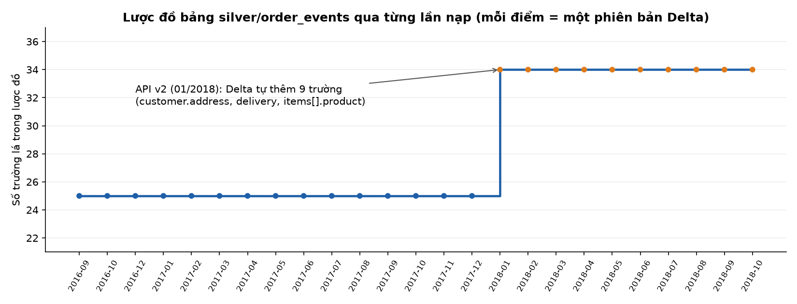
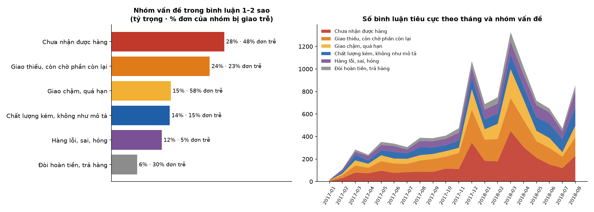
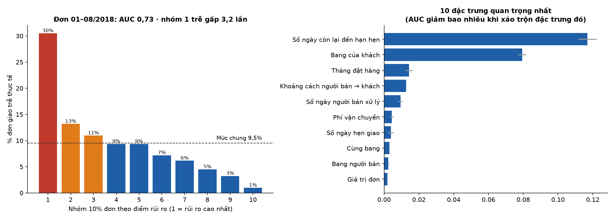

# Phần mở rộng: Lakehouse cho dữ liệu bán cấu trúc & không cấu trúc · Ứng dụng AI

Xem trực tuyến: **https://thanh-2312.github.io/OlistDashboard/mo_rong.html**. Trang có ô *"Thử AI đọc cảm xúc"*: mô hình chạy ngay trong trình duyệt.

Hai hướng mở rộng đi sâu của đồ án Kho dữ liệu & BI (dữ liệu Olist Brazilian E-commerce):

| Hướng | Notebook | Nội dung |
|---|---|---|
| 1. Lakehouse xử lý dữ liệu bán cấu trúc & không cấu trúc | [N6](notebooks/N6_Lakehouse_ban_cau_truc_khong_cau_truc.ipynb) | 10 job L13 → L22 nối tiếp lakehouse Delta (Bronze → Silver → Gold): JSON từ 3 API thật, đơn hàng dạng JSON lồng nhau có 2 phiên bản API, 42.678 bình luận tự do |
| 2. Ứng dụng AI trong khai thác dữ liệu | [N7](notebooks/N7_AI_khai_thac_du_lieu.ipynb) | Phân loại cảm xúc bình luận, tìm chủ đề phàn nàn, dự báo đơn sắp giao trễ; kết quả ghi ngược vào Gold |

## Kết quả chính

**Lakehouse**
- 3 API công khai (Ngân hàng Trung ương Brazil, IBGE SIDRA, BrasilAPI) cho 6.208 bản ghi JSON. Mỗi phản hồi lưu nguyên văn ở vùng hạ cánh. Bronze nạp **lũy đẳng** bằng MERGE: nạp lại thêm 0 dòng.
- Quy đổi doanh thu theo tỷ giá đúng ngày: T1–8/2018 tăng **+138% theo BRL nhưng +117% theo USD** (BRL mất giá 11%).
- Độ phủ thị trường: cả nước 47 đơn / 100.000 dân; São Paulo 90; Amazonas 3,6.
- 99.441 đơn được đóng gói thành tài liệu JSON lồng nhau (dữ liệu thật, hình dạng mô phỏng webhook). Từ 01/2018 nguồn đổi sang API v2:
  - **Schema evolution**: Delta tự thêm 9 trường.
  - **Schema enforcement + ACID**: tiền dạng chữ `"1299,00"` bị từ chối cả lô, phiên bản bảng giữ nguyên 14 → 14.
  - 3 dòng hỏng được cách ly.
  - Làm phẳng bằng DuckDB `UNNEST` khớp 100% bảng gốc.
- Văn bản: che 26 chuỗi dữ liệu cá nhân (số điện thoại, link, số hóa đơn), tạo chỉ mục từ. Phát hiện **1.107 đơn ghi "giao đúng hạn" nhưng khách viết "chưa nhận được"**.

**AI** – kiểm tra trên dữ liệu tương lai mà mô hình chưa từng thấy

| Bài toán | Phương pháp | Kết quả |
|---|---|---|
| Cảm xúc bình luận | TF-IDF (từ + ký tự) + hồi quy logistic | Đúng 95%, AUC 0,98 (quy tắc từ khóa: 88%); tìm ra 801 bình luận 4–5 sao nhưng lời chê |
| Chủ đề phàn nàn | NMF 8 chủ đề → 6 nhóm vấn đề | 66% lời chê liên quan giao hàng; đỉnh 03/2018 |
| Dự báo giao trễ | HistGradientBoosting, 18 đặc trưng lúc bàn giao vận chuyển | AUC 0,73 (quy tắc đơn giản 0,62); 10% đơn rủi ro nhất trễ gấp 3,2 lần |





## Thư mục

| Đường dẫn | Nội dung |
|---|---|
| `notebooks/` | N6, N7 đã chạy sẵn kết quả |
| `src/N6.py`, `src/N7.py` | Nguồn của notebook (định dạng `# %%`) |
| `src/olist_utils.py` | Hằng số và hàm dùng chung (`norm_text`, `STOP_PT`…) |
| `src/make_notebooks.py` | Ghép `# %%` thành `.ipynb` rồi chạy |
| `src/web_mo_rong.py` | Sinh `../mo_rong_data.js` (số liệu + mô hình cảm xúc dạng JSON) và chép các file vào thư mục này |
| `charts/` | 8 biểu đồ dùng trong báo cáo |
| `du_lieu_mau/` | Phản hồi API nguyên văn + 40 tài liệu đơn hàng v1, 40 tài liệu v2 kèm 3 dòng hỏng cố ý |

## Chạy lại

Các script chạy trong thư mục dự án đầy đủ (cần 9 file CSV Olist và notebook N1–N5 đã tạo kho SQLite và lakehouse). Hồ dữ liệu (khoảng 300 MB) không đưa lên repo.

```bash
python _build/make_notebooks.py N6 N7   # khoảng 3 phút; API chỉ gọi lần đầu, sau đó đọc file đã lưu
python _build/web_mo_rong.py           # sinh lại mo_rong_data.js và thư mục mo_rong/
```

Thư viện: deltalake, duckdb, pandas, pyarrow, requests, scikit-learn, matplotlib; trang web dùng Chart.js.
